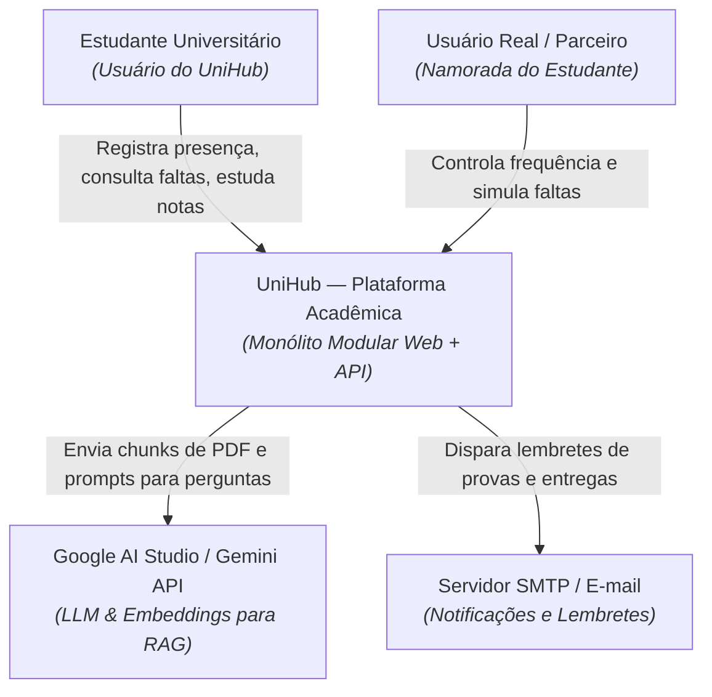
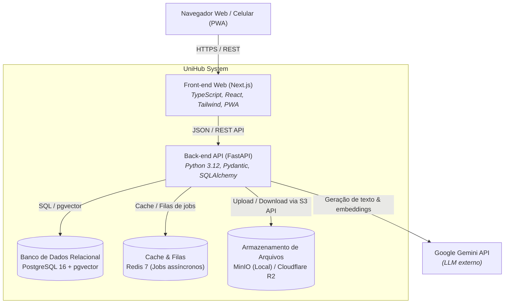

# Arquitetura UniHub — Modelo C4

O **Modelo C4** é uma abordagem padrão na indústria de software para descrever e comunicar a arquitetura de sistemas em diferentes níveis de zoom (como o Google Maps).

---

## 🗺️ Nível 1 — Diagrama de Contexto do Sistema

Mostra o UniHub no centro, quem são os usuários e quais sistemas externos interagem com a plataforma.

---

## 📦 Nível 2 — Diagrama de Contêineres

Dá um "zoom" dentro do UniHub e mostra as aplicações, bancos de dados e sistemas de armazenamento que compõem o sistema.

---

## 🏛️ Princípios Arquiteturais Adotados

1. **Monólito Modular:** Todos os domínios do backend coexistem em uma única base de código (`apps/api`), mantendo isolamento estrito entre si através de interfaces públicas (veja o [ADR 0001](../adr/0001-monolito-modular.md)).
2. **Defesa em Profundidade (Cibersegurança):** Acesso a qualquer recurso requer autenticação e autorização por `user_id`. Nenhuma tabela de usuário é exposta diretamente.
3. **Custo Zero:** Todas as dependências de infraestrutura rodam via Docker localmente ou em free tiers sem necessidade de cartão de crédito.
